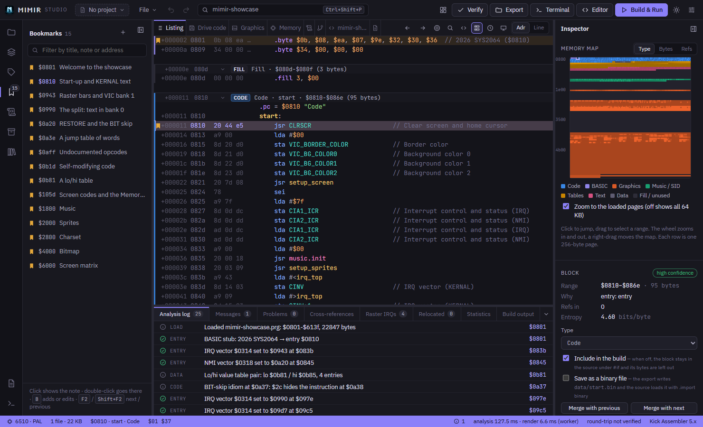
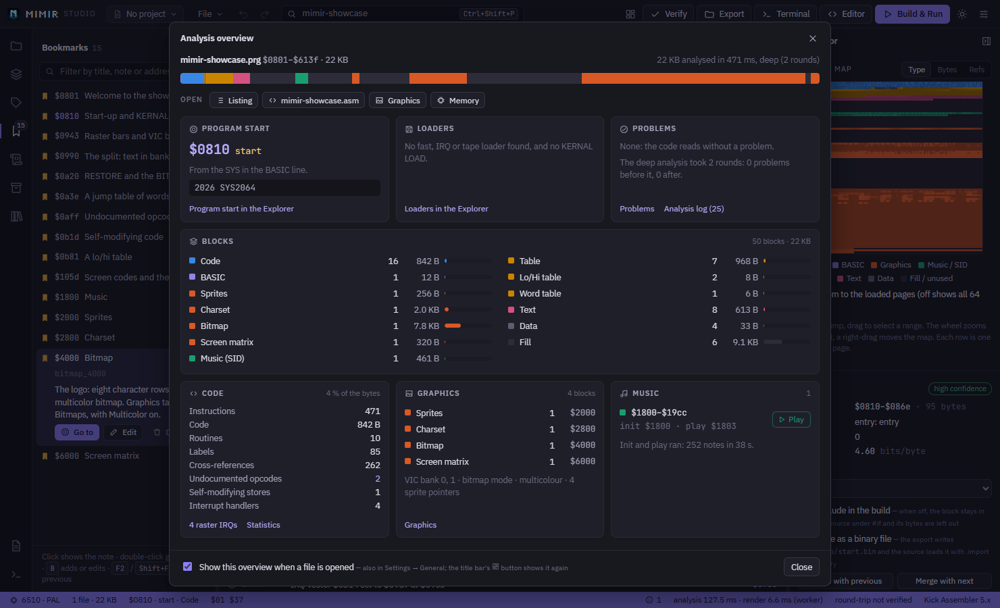
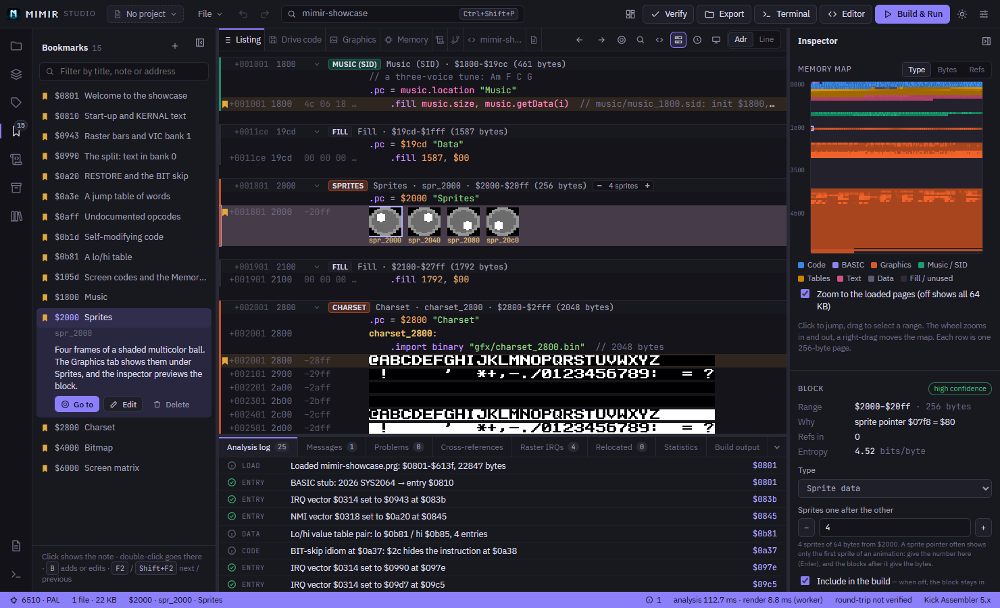
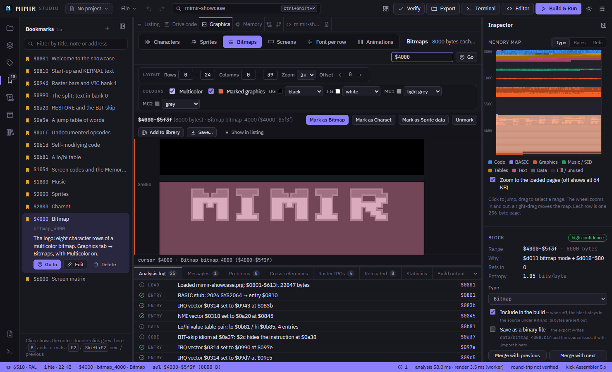

<p align="center"></p>

# Mimir Studio

**Turn Commodore 64 programs back into source code you can read, change and rebuild.**

Mimir Studio is a desktop IDE for re-assembling C64 software. Open a program, a disk, a tape, a cartridge or a VICE
snapshot. Mimir traces the code, recognises graphics, music, tables and text, and names every hardware register and
KERNAL routine. Rename, comment and re-type what you like, then export a [Kick Assembler](http://theweb.dk/KickAssembler/)
or [64tass](https://sourceforge.net/projects/tass64/) project that assembles back to **exactly the same bytes**.

*Named after Mímir, who keeps the well of wisdom in Norse myth.*



## Features

- **Byte-exact round trip.** The exported source is assembled again and compared byte for byte with the original
  (`F7`).
- **Opens it all:** `.prg`, `.d64` and `.g64` disks, `.tap` and `.t64` tapes, `.crt` cartridges (every bank) and VICE
  snapshots (`.vsf`).
- **An analysis that knows the C64.** It follows `$01` and the VIC bank along every code path, and finds interrupt
  handlers, raster IRQs, relocated code, timing code and routines you have named before. An analysis overview after
  each load shows what it found.
- **Recognises what demos and games are made of:** SID music and samples, charsets, sprites, bitmaps, screens, tables
  and text. Graphics are drawn as pictures right in the listing.
- **Loaders, packers and protections.** Disks for Spindle, Krill's loader, Bitfire, Sparkle, BoozeLoader and others,
  the big publishers' tape loaders, IFFL files and freezer backups are read, with their load scripts rebuilt. Packed
  programs unpack with one click in [Sindri](https://github.com/MikaelEriksson072/Sindri), Mimir's own unpacker: an
  emulated C64 with a disk drive and a datasette.
- **Edit anything, undo anything:** labels, comments, block types, splits and merges, relocation, patches (cycle
  counts kept if you like) and scripts that run in an emulated 6510 with a step debugger.
- **Graphics and Memory tabs** to browse all 64 KB, mark what you find and save it (PNG, Koala, raw, source), and a
  **library** for the SID tunes, sprites, charsets and pictures you collect.
- **The toolchain built in:** Build & Run in VICE (`F5`) or a debugger (`Shift+F5`), packing with
  [Brokkr](https://github.com/MikaelEriksson072/Brokkr), Mimir's own cruncher, or Exomizer, build templates, a terminal
  and a Git tab.

<table>
  <tr>
    <td width="33%"><a href="docs/images/overview.png"></a></td>
    <td width="33%"><a href="docs/images/listing-graphics.png"></a></td>
    <td width="33%"><a href="docs/images/graphics.png"></a></td>
  </tr>
  <tr>
    <td align="center">Analysis overview</td>
    <td align="center">Graphics in the listing</td>
    <td align="center">Graphics tab</td>
  </tr>
</table>

## Download

Get Mimir Studio from [Releases](https://github.com/MikaelEriksson072/mimir-studio/releases) (Windows 10 or 11,
64-bit):

- **`Mimir-Studio-<version>-portable.exe`** runs without installing: download it and double-click.
- **`Mimir-Studio-<version>-setup.exe`** installs it, with shortcuts in the Start menu and on the desktop.

Nothing else is needed to open, analyse, verify and export; Exomizer and 64tass come with it. Build & Run also needs
[VICE](https://vice-emu.sourceforge.io/), and a Kick Assembler project needs Java with KickAss.jar. Mimir finds them in
the usual folders, and **Settings → Toolchain** changes them. The files are not code-signed, so Windows may say "Windows protected your PC":
click **More info → Run anyway**.

## Building from source

You need Windows 10 or 11, [Node.js](https://nodejs.org/) 22.12 or newer and [pnpm](https://pnpm.io/) 9
(`corepack enable pnpm`). Java with Kick Assembler, VICE and [Git](https://git-scm.com/) are optional; Mimir finds them
in the usual folders, and **Settings → Toolchain** changes them.

```bash
pnpm install
pnpm dev
```

`pnpm --filter @mimir/desktop package` builds the installer in `apps/desktop/release/<version>/`.

Not sure where to start? **Demo** in the Explorer loads a showcase with a guided tour (`F2`).

### Command line

The analysis also runs without the app:

```bash
pnpm mimir analyse game.prg
```

Other commands: `verify`, `export -o <folder>`, `unpack` (a PRG, disk or tape) and `measure <folder>`.

## Project layout

| Folder | What is in it |
|---|---|
| `packages/core` | the analysis, the assembler output and the verification |
| `packages/cli` | the command line |
| `packages/sindri` | Sindri, the unpacker ([its README](packages/sindri/README.md)) |
| `packages/brokkr` | Brokkr, the cruncher ([its README](packages/brokkr/README.md)) |
| `apps/desktop` | the Electron app (React) and its end-to-end tests |
| `docs` | [the specification](docs/spec.md) (in Swedish) and [the development notes](docs/DEVELOPMENT.md) |

`pnpm test` runs the tests, `pnpm typecheck` checks the types.

## Third-party tools

The installer includes two tools, unchanged, from `apps/desktop/vendor/`:

- **Exomizer 3.1.1** by Magnus Lind, free for **non-commercial, non-profit** use as long as its notice (`LICENSE.txt`)
  stays with it. Do not sell a build that includes it.
- **64tass 1.57** by Zsolt Kajtar, under the GPL-2.0 (its licences come along).

Kick Assembler, Java and VICE are not included.

## License

Mimir Studio is free software under the [GNU General Public License, version 3](LICENSE) (GPL-3.0-only), without any
warranty. The bundled tools keep their own licences.
